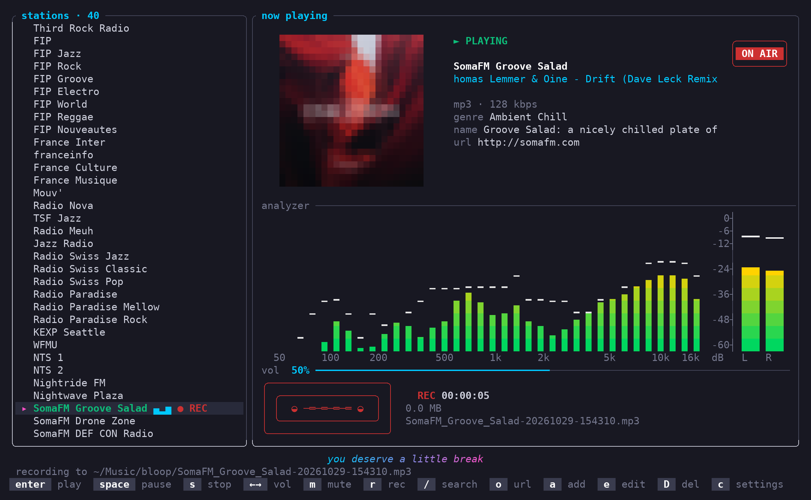
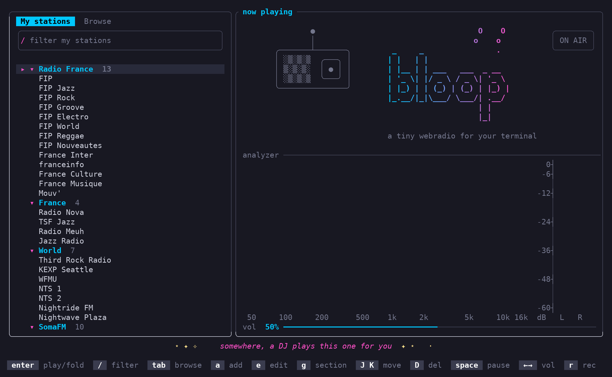
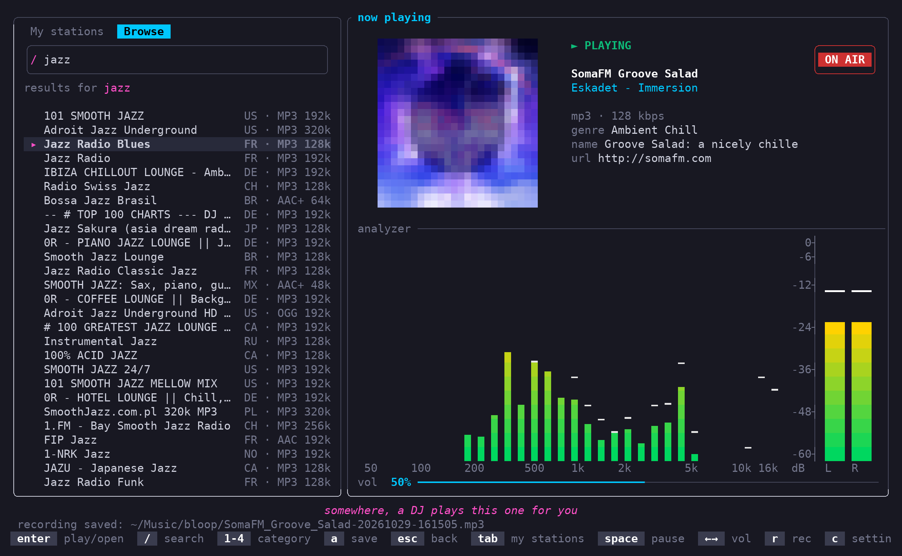

```
             O     o
            o   .
 _     _      .
| |   | |
| |__ | | ___   ___  _ __
| '_ \| |/ _ \ / _ \| '_ \
| |_) | | (_) | (_) | |_) |
|_.__/|_|\___/ \___/| .__/
                    | |
                    |_|
```

**bloop** is a tiny web radio player for the terminal. It uses Rust and [ratatui](https://ratatui.rs). It has its own audio engine and does not need an external player.



## Features

- Play internet radio streams: MP3, AAC, HE-AAC, Ogg Vorbis and FLAC. bloop does not play HLS streams.
- Save stations with a name and an image, and sort them in sections.
- Browse and search more than 50 000 stations on [radio-browser.info](https://www.radio-browser.info): popular stations, top voted stations, genres and countries.
- Show the song title and the stream metadata.
- Show the album cover of the current song.
- Record the stream to a file. bloop does not re-encode the audio.
- Show a spectrum analyzer and a stereo level meter. The meters use the real audio levels.
- Show high-resolution images in terminals with sixel, kitty or iTerm2 graphics. Other terminals show half-block images.

| My stations | Browse |
| --- | --- |
|  |  |

## Requirements

- Linux or macOS. On Windows, use WSL2.
- On Linux, a PulseAudio or PipeWire sound server. WSLg and most desktops have one.

bloop is tested on Ubuntu 24.04 (WSL2) with Windows Terminal.

## Installation

### From a release

1. Download the archive for your system from the [releases page](../../releases):

   - `x86_64-unknown-linux-musl`: Linux and WSL on x86_64.
   - `aarch64-apple-darwin`: macOS on Apple silicon.

2. Extract the archive and put `bloop` in a directory of your `PATH`:

   ```sh
   tar xzf bloop-v0.2.0-x86_64-unknown-linux-musl.tar.gz
   install bloop-v0.2.0-x86_64-unknown-linux-musl/bloop ~/.local/bin/
   ```

3. Start bloop:

   ```sh
   bloop
   ```

### From the source code

1. Install Rust 1.88 or later and a C compiler. On Linux, also install the ALSA development files:

   ```sh
   sudo apt install build-essential pkg-config libasound2-dev    # Debian, Ubuntu, WSL
   ```

2. Build and install bloop:

   ```sh
   cargo install --path . --locked
   ```

### Make a release

1. Change the version in `Cargo.toml`.
2. Commit the change.
3. Push a tag with the same version:

   ```sh
   git tag v0.2.0
   git push origin v0.2.0
   ```

GitHub Actions builds the archives and publishes the release.

## Keys

The sidebar has two tabs. Push `tab` to go from one tab to the other.

- **My stations** shows your stations in sections.
- **Browse** shows stations from radio-browser.info.

### All views

| Key | Action |
| --- | --- |
| `tab` | Go to the other tab |
| `↑` `↓` | Select the previous or next row |
| `/` | Type in the search bar |
| `space` | Pause or resume |
| `s` | Stop |
| `-` `+` | Decrease or increase the volume (`=` also increases it) |
| `m` | Mute |
| `r` | Start or stop the recording |
| `o` | Play a stream URL |
| `c` | Open the settings |
| `q` or `ctrl+c` | Quit |

### My stations

| Key | Action |
| --- | --- |
| `enter` | Play the station, or open or close the section |
| `←` `→` | Close or open the section |
| `a` | Add a station |
| `e` | Edit the station, or rename the section |
| `g` | Move the station to a different section |
| `J` `K` | Move the station down or up in its section |
| `D` | Delete the station |

### Browse

| Key | Action |
| --- | --- |
| `1` `2` `3` `4` | Show popular stations, top voted stations, genres or countries |
| `←` `→` | Show the previous or next category |
| `enter` | Play the station, or open the genre or country |
| `a` | Save the station in a section |
| `esc` or `←` | Go back to the list of genres or countries |

### Search bar

| Key | Action |
| --- | --- |
| `enter` | Stop typing |
| `esc` | Clear the text and stop typing |
| `ctrl+u` | Clear the text |

In **My stations**, the search bar filters your stations. In **Browse**, it searches all stations while you type.

### Mouse

| Action | Result |
| --- | --- |
| Click a tab, a category or the search bar | Selects it |
| Click a station | Selects the station |
| Double-click a station, a genre or a country | Plays the station, or opens the genre or country |
| Click a section header | Opens or closes the section |
| Click a key in the bottom bar | Does the same as the key |
| Click the image or the ON AIR sign | Pauses or resumes |
| Click the volume bar | Sets the volume |
| Mouse wheel on a list | Selects the previous or next row |
| Mouse wheel on the player | Decreases or increases the volume |

bloop captures the mouse. To select text in the terminal, hold `shift` while you drag.

## Settings

Push `c` to open the settings. bloop saves each change immediately.

| Setting | Default | Description |
| --- | --- | --- |
| Spectrum analyzer | off | Shows the levels of 32 frequency bands. |
| Audio level meter | off | Shows the left and right levels in dBFS. |
| Album covers | on | Finds the cover of the current song. |
| High-res images | on | Uses sixel, kitty or iTerm2 graphics if the terminal supports them. |
| Meter delay | 250 ms | Moves the meters in time with the speakers. |

The meters need CPU time. When both meters are off, bloop does not analyze the audio.

## Files

| File | Content |
| --- | --- |
| `~/.config/bloop/stations.json` | Your stations and their sections |
| `~/.config/bloop/settings.json` | Your settings, the volume, the last station and the closed sections |
| `~/Music/bloop/` | Your recordings |

## Privacy

bloop sends data to these services:

- **iTunes Search API**: the title of the current song, when the "Album covers" setting is on.
- **radio-browser.info**: the text of your station search, and the genre or country that you open.
- **Station logo servers**: a request for the logo of the station that you play.
