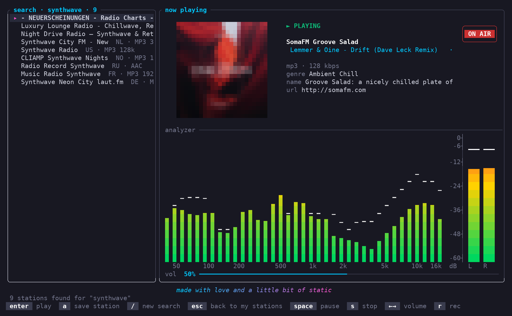

```
             O     o
            o   .
 _     _      .
| |   | |
| |__ | | ___   ___  _ __
| '_ \| |/ _ \ / _ \| '_ \
| |_) | | (_) | (_) | |_) |
|_.__/|_|\___/ \___/| .__/
                    | |
                    |_|
```

**bloop** is a tiny web radio player for the terminal. It uses Rust, [ratatui](https://ratatui.rs) and [mpv](https://mpv.io).


## Features

- Play internet radio streams (MP3, AAC, Ogg, HLS and more).
- Save stations with a name and an image.
- Search more than 50 000 stations on [radio-browser.info](https://www.radio-browser.info).
- Show the song title and the stream metadata.
- Show the album cover of the current song.
- Record the stream to a file. bloop does not re-encode the audio.
- Show a spectrum analyzer and a stereo level meter. The meters use the real audio levels.
- Show high-resolution images in terminals with sixel, kitty or iTerm2 graphics. Other terminals show half-block images.

| Start screen | Station search |
| --- | --- |
|  |  |

## Requirements

- Linux or macOS. On Windows, use WSL2.
- Rust 1.88 or later.
- mpv. bloop starts mpv to play the audio.

bloop is tested on Ubuntu 24.04 (WSL2) with Windows Terminal.

## Installation

1. Install mpv:

   ```sh
   sudo apt install mpv
   ```

2. Build and install bloop:

   ```sh
   cargo install --path .
   ```

3. Start bloop:

   ```sh
   bloop
   ```

## Keys

| Key | Action |
| --- | --- |
| `enter` | Play the selected station |
| `space` | Pause or resume |
| `s` | Stop |
| `←` `→` | Decrease or increase the volume |
| `m` | Mute |
| `r` | Start or stop the recording |
| `/` | Search for stations |
| `o` | Play a stream URL |
| `a` | Add a station |
| `e` | Edit the selected station |
| `D` | Delete the selected station |
| `c` | Open the settings |
| `q` | Quit |

In the search results, push `a` to save the selected station. Push `esc` to go back to your stations.

## Settings

Push `c` to open the settings. bloop saves each change immediately.

| Setting | Default | Description |
| --- | --- | --- |
| Spectrum analyzer | off | Shows the levels of 32 frequency bands. |
| Audio level meter | off | Shows the left and right levels in dBFS. |
| Album covers | on | Finds the cover of the current song. |
| High-res images | on | Uses sixel, kitty or iTerm2 graphics if the terminal supports them. |
| Meter delay | 250 ms | Moves the meters in time with the speakers. |

The meters need CPU time. When both meters are off, bloop does not analyze the audio.

## Files

| File | Content |
| --- | --- |
| `~/.config/bloop/stations.json` | Your stations |
| `~/.config/bloop/settings.json` | Your settings |
| `~/Music/bloop/` | Your recordings |

## Privacy

bloop sends data to these services:

- **iTunes Search API**: the title of the current song, when the "Album covers" setting is on.
- **radio-browser.info**: the text of your station search.
- **Station logo servers**: a request for the logo of the station that you play.
